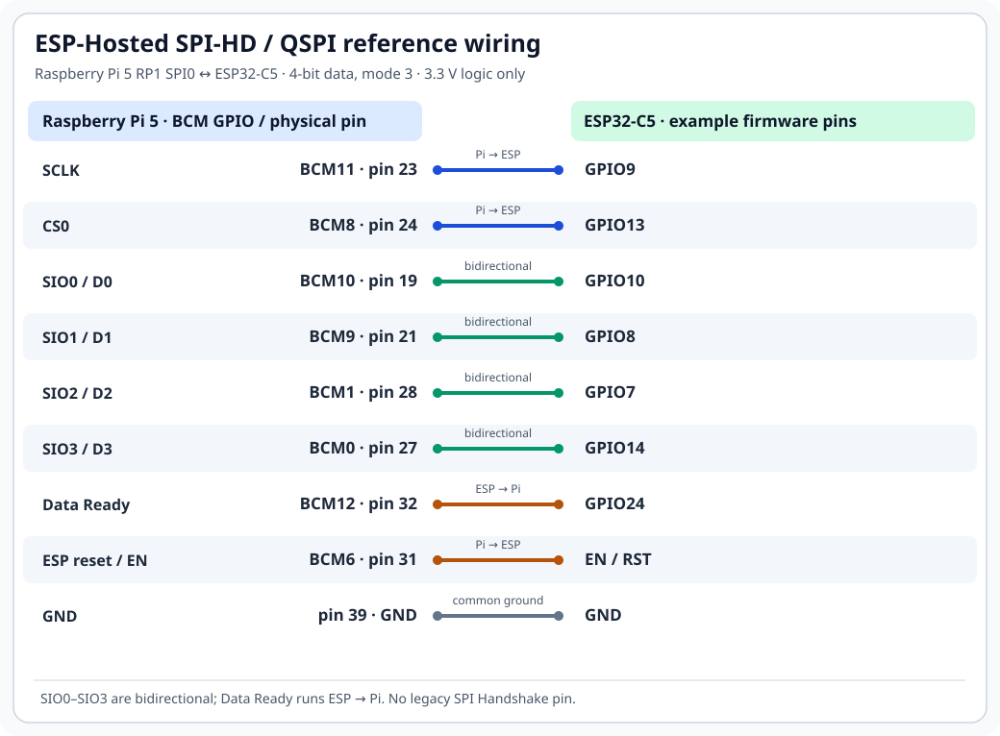

# SPI-HD / QSPI on Raspberry Pi 5

ESP-Hosted SPI-HD uses ESP SPI Slave-HD v2. Control transactions use a
single data line. Data transfers can use four bidirectional lines
(SIO0–SIO3). SPI-HD is separate from standard full-duplex SPI and needs
no Handshake GPIO.

## Hardware requirements

- ESP32-S2, ESP32-S3, ESP32-C2, ESP32-C3, ESP32-C5, ESP32-C6,
  ESP32-C61 or ESP32-S31 with SPI Slave-HD v2. Original ESP32 lacks
  this peripheral.
- Linux host with a quad-capable SPI controller and driver supporting
  command/address/data transfers and chip-select control.
- GPIO for Data Ready and optional ESP reset.
- Common ground and 3.3 V logic.

Raspberry Pi 5 RP1 SPI0 serves as reference host. Pi 4 and older onboard
SPI controllers lack quad support. Other hosts need compatible controller
drivers and pin configuration.

## Raspberry Pi 5 wiring



Pi GPIOs use BCM numbering. Header pin numbers refer to Raspberry Pi
40-pin connector. ESP GPIOs match default ESP32-C5 SPI-HD configuration.

SIO0–SIO3 are bidirectional. Use SPI mode 3 on both ends. Keep wiring short
and verify ESP board pin assignments before connecting hardware. No
separate SPI Handshake line is needed.

### Default ESP GPIO assignments

Select pins through **Example Configuration → SPI Half-duplex/QIO
Configuration** in ESP-IDF menuconfig.

| ESP target | CS | CLK | D0 | D1 | D2 | D3 | Data Ready | ROM bus |
|---|---:|---:|---:|---:|---:|---:|---:|---|
| ESP32-S2 / ESP32-S3 | 10 | 12 | 11 | 13 | 14 | 9 | 4 | SPI |
| ESP32-C2 | 10 | 6 | 7 | 2 | 5 | 4 | 1 | SPI |
| ESP32-C3 | 10 | 6 | 7 | 2 | 5 | 4 | 3 | SPI |
| ESP32-C5 | 13 | 9 | 10 | 8 | 7 | 14 | 24 | SDIO/card-SPI |
| ESP32-C6 | 23 | 19 | 18 | 20 | 21 | 22 | 6 | SDIO/card-SPI |
| ESP32-C61 | 23 | 26 | 25 | 27 | 28 | 22 | 5 | SDIO/card-SPI |
| ESP32-S31 | 23 | 20 | 21 | 22 | 25 | 24 | 18 | GPSPI |

Values above refer to ESP GPIOs. The default wiring reuses the ROM SPI or
SDIO/card-SPI bus pins for runtime SPI-HD; D0/D1 correspond to MOSI/MISO
and the two additional lanes use the remaining quad or SDIO pins. ROM
provisioning and runtime SPI-HD are mutually exclusive bus owners. The
ROM pin mapping alone does not establish provisioning support. Check boot
straps, console routing, flash/PSRAM reservations and board schematics
before connecting; GPIO3 on C3 must be low during SPI-download selection.
C5 GPIO13/14 are shared with USB Serial/JTAG, so use a non-conflicting
console route with this pin map.

## Build ESP firmware

Set up ESP-IDF as described in
[Build, flash, and load](getting-started/build-and-flash.md).

```sh
cd esp/esp_driver/network_adapter
idf.py set-target esp32c5
idf.py menuconfig
```

Select **Example Configuration → Transport layer → SPI half-duplex/QIO
interface**. Check SPI mode 3 and GPIO assignments under **SPI
Half-duplex/QIO Configuration**. DMA append, TX batching and TX length
mirroring are enabled by default. Build the host and firmware from matching
sources: the versioned SPI-HD protocol does not support older experimental
firmware. No SPI-HD-specific module parameters are required.

Build and flash using ESP board serial port:

```sh
idf.py build
idf.py -p /dev/ttyUSB0 flash
```

Change target and serial port for your board.

## Set up Raspberry Pi 5

RP1 SPI0 needs a Linux controller driver with quad-transfer support.
Build controller modules against running kernel before loading
ESP-Hosted:

```sh
cd host
bash rpi5_spi_hd/build-rp1-quad-modules.sh --load
```

This command replaces loaded SPI controller modules. Run it only when
other devices on same SPI bus are idle.

Build and load SPI-HD host driver:

```sh
./rpi_init.sh spi_hd resetgpio=6 datareadygpio=12 \
    max_frequency=40000000
```

`resetgpio` and `datareadygpio` use Pi BCM numbering.
The SPI-HD Linux driver also supports Device Tree configurations without
`reset-gpios` when the ESP is already booted and publishing Slave Ready.
`data-ready-gpios` remains required. Without a reset GPIO, the driver can
perform normal transfers but **cannot reset or automatically recover an
unresponsive ESP**; arrange recovery externally if the board has no reset
connection. Omitting the GPIO is not a substitute for initial firmware boot.

ESP-Hosted describes command, address, dummy and data phases through the
generic Linux SPI API. Controller-specific QIO framing belongs in the host
SPI controller driver. Other hosts need compatible controller and Device Tree
configuration. The Linux SPI controller advertises independent TX-quad
and RX-quad capabilities. SPI-HD uses TX-only quad mode for enhanced H2E
writes with a single-line address. Enhanced E2H reads require **both**
TX-quad (the address phase) and RX-quad (the data phase); an RX-only quad
controller therefore uses the safe single-line read fallback. The driver
checks every transfer phase against the advertised Linux SPI capabilities
before submitting it. Controllers must support the required wire phases,
chip-select semantics and transfer sizes. The host and firmware negotiate
clock limits, RX descriptor capacity and host receive capacity. A controller
that can carry a full Hosted frame may use smaller aggregates automatically.
Control phases use 8-bit words. Aligned bulk quad payloads may use 32-bit
words when the controller advertises support; byte order is preserved.
Other payloads use 8-bit transfers. Every Hosted frame is zero-padded to a
four-byte wire boundary; the header length and checksum exclude padding.
The shared protocol header lives in host/include and is required when
building the firmware from source.

## Verify connection

Check module load, SPI probe and Wi-Fi interface:

```sh
lsmod | grep esp32_spi_hd
dmesg | grep -i -E 'spi.hd|esp32'
iw dev
ip link
```

If Wi-Fi interface is missing, check ESP UART log and host `dmesg`.
Verify GPIOs, SPI mode, Data Ready signal, quad support and SPI0 driver
ownership. See [Troubleshooting](troubleshooting.md).
